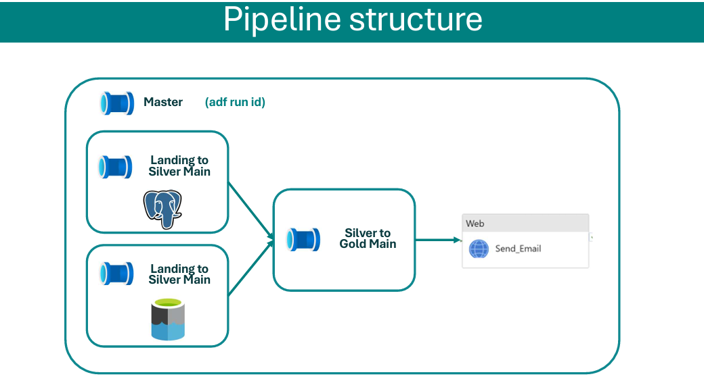
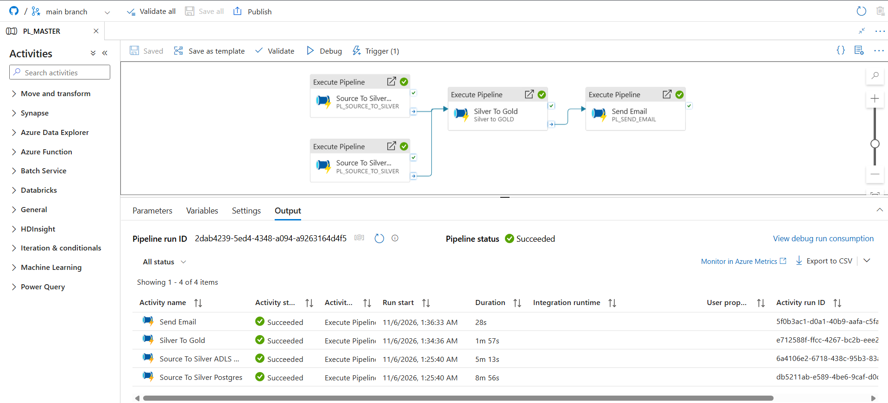
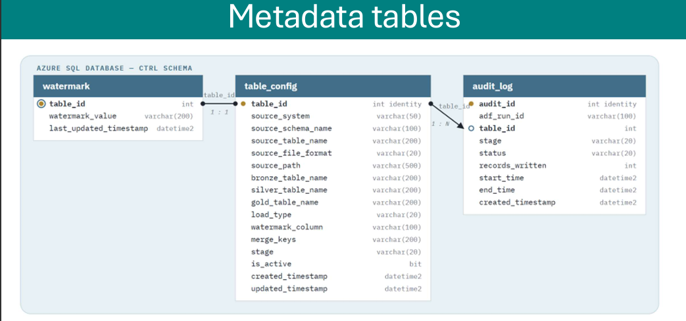
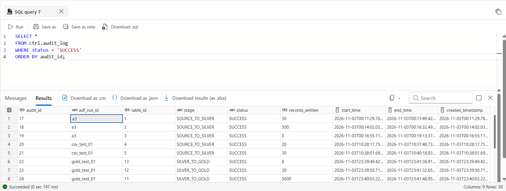
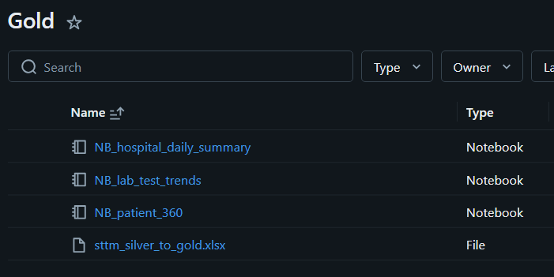
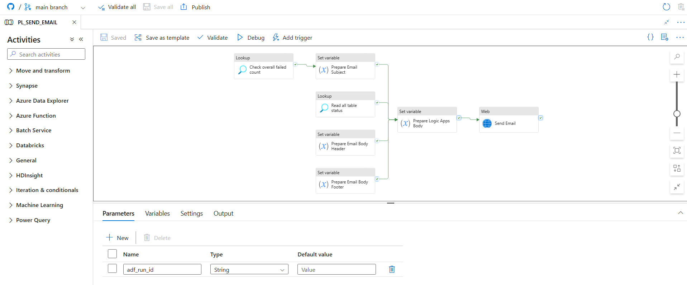
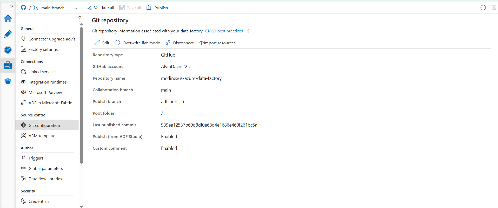
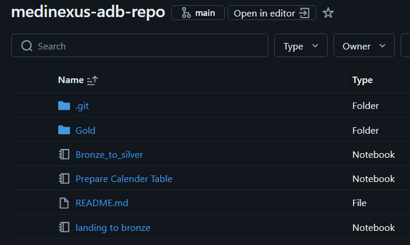

# MediNexus — End-to-End Healthcare Data Platform

MediNexus is an Azure data engineering portfolio project that brings together healthcare data from an internal relational system and external partner files, processes it through a metadata-driven lakehouse pipeline, and serves curated results through dashboards and natural-language analytics.

The project demonstrates the full path from source onboarding to analytical consumption: Azure Data Factory orchestration, Azure SQL control metadata, ADLS Gen2 landing storage, reusable Databricks notebooks, Delta Lake tables, Unity Catalog governance, audit and email notification, GitHub workflows, and evidence-based data validation.

> **Data notice:** The healthcare datasets are demonstration data. MediNexus is a portfolio implementation, not a production clinical system, and does not represent real patient information.

<p align="center"><strong>2 source systems · 5 source datasets · 3 load strategies · 8 metadata mappings · 3 Gold datasets · 4 dashboard views</strong></p>

## Project overview

| Area | Implementation |
|---|---|
| Data sources | Neon PostgreSQL and partner CSV files in ADLS Gen2 |
| Orchestration and ingestion | Azure Data Factory pipelines driven by Azure SQL metadata |
| Storage and transformation | ADLS Gen2, Azure Databricks, PySpark, Delta Lake |
| Data organization | Unity Catalog with Landing, Bronze, Silver, and Gold schemas |
| Control and audit | Azure SQL `ctrl` tables for configuration, watermarks, and run history |
| Consumption | Databricks healthcare dashboard, Genie Agent, and Genie ONE |
| Security and notifications | Azure Key Vault, managed identity/access connector, Logic Apps |
| Source control | GitHub repositories for ADF, Databricks, and portfolio documentation |

### What the project demonstrates

- A reusable ingestion framework for both relational tables and file feeds.
- Full, append-only, and merge/upsert processing selected through metadata.
- Per-table and per-stage execution records tied together by a shared ADF run ID.
- Reusable Bronze and Silver notebooks, plus metadata-selected Gold transformations.
- Analytical datasets for patient, hospital, and laboratory reporting.
- A working consumption layer with a multi-view dashboard and natural-language query examples.

## Architecture

ADF coordinates the platform and reads its processing instructions from Azure SQL. PostgreSQL tables and CSV files enter a timestamped Landing zone in ADLS Gen2. Databricks processes each batch through Bronze and Silver, then builds Gold tables for reporting. Audit state, notifications, governance, credentials, and source control support the processing flow end to end.

<p align="center">
  
  <br><em>End-to-end platform view: sources, orchestration, medallion processing, governance, and consumption.</em>
</p>

```text
Neon PostgreSQL ─┐                               ┌─> Healthcare dashboard
                 ├─> Azure Data Factory ─> ADLS ─> Landing ─> Bronze ─> Silver ─> Gold ─┤
Partner CSVs ────┘            │                  │                                 └─> Genie
                              └─ Azure SQL control plane
                                 table_config / watermark / audit_log

Supporting services: Azure Databricks + Delta Lake + Unity Catalog
                     Azure Key Vault + managed identity + Logic Apps
                     GitHub source control and reviewed publishing workflow
```

## Data sources

MediNexus combines an internal hospital system with external partner feeds. The five configured source datasets share a common metadata framework while retaining source-specific loading behavior.

| Source | Dataset | Business content | Load strategy | Incremental field / key |
|---|---|---|---|---|
| Neon PostgreSQL | `hospitals` | Hospital details and capacity | Full refresh | — |
| Neon PostgreSQL | `doctors` | Doctors linked to hospitals | Full refresh | — |
| Neon PostgreSQL | `patients` | Patient, registration, and insurance links | Watermark + merge | `updated_at` / `patient_id` |
| ADLS Gen2 CSV | `lab_results` | Test, result, status, and reported date | New-file append | `reported_at` |
| ADLS Gen2 CSV | `insurance_providers` | Provider and coverage information | Full refresh | — |

PostgreSQL records connect through hospital, doctor, patient, and insurance identifiers. Lab-result records refer back to the same entities, allowing the Gold layer to produce patient, hospital, and test-level views.

<p align="center">
  
  <br><em>Relational source tables and partner-file entities linked by the healthcare business keys.</em>
</p>

## Azure Data Factory: ingestion and orchestration

ADF is the orchestration and ingestion layer. Its pipelines are parameterized and use metadata rather than maintaining separate table-specific pipeline logic. The PostgreSQL branch builds a query from the configured schema, table, load type, and watermark. The file branch copies partner CSVs from the ADLS `source` container without changing their original CSV content. Factory-level parameters hold shared environment and notification settings, and linked services connect ADF to PostgreSQL, ADLS Gen2, Azure Databricks, Azure SQL, and Key Vault.

### Landing zone

Every batch is written under a source, dataset, and timestamp path:

```text
landing/<source_system>/<table_name>/<landing_timestamp>/<file>
```

PostgreSQL extracts are written as Parquet; partner CSV files are copied as-is. The timestamped folders let the Bronze notebook identify the exact batch being processed while preserving each ingestion run.

<p align="center">
  
  <br><em>Shared Landing layout for PostgreSQL extracts and partner CSV files.</em>
</p>

### Pipeline hierarchy

| Pipeline | Responsibility |
|---|---|
| `PL_MASTER` | Starts PostgreSQL and CSV source-to-Silver runs in parallel with one shared ADF run ID, waits for both branches to finish, invokes Silver-to-Gold, then sends the completion notification. Gold is attempted on branch completion even when a source branch fails; the final email reports the run status. |
| `PL_SOURCE_TO_SILVER_MAIN` | Looks up active source configuration, loops over the selected datasets, creates in-progress audit rows, invokes the per-table pipeline, and records failures so they propagate to the outer run. |
| `PL_SOURCE_TO_SILVER_INNER` | Performs one configured table's work: reads configuration and watermark as needed, copies data to Landing, runs Landing-to-Bronze and Bronze-to-Silver notebooks, updates audit status, and advances incremental state after successful processing. |
| `PL_SILVER_TO_GOLD` | Selects active Gold mappings from metadata, loops through them, invokes the matching Gold notebook, and records the result for each output. |
| `PL_SEND_EMAIL` | Summarizes the current run's table statuses and failed count, then posts the notification payload to the Logic App. |

The shared run ID is passed down the pipeline hierarchy and links table-level records from both processing stages to the same end-to-end execution.

<table>
  <tr>
    <td width="50%"></td>
    <td width="50%"></td>
  </tr>
  <tr>
    <td align="center"><em>PL_MASTER: parallel ingestion, Gold processing, then notification.</em></td>
    <td align="center"><em>Pipeline hierarchy with one run ID passed through each stage.</em></td>
  </tr>
</table>

<table>
  <tr>
    <td width="50%"></td>
    <td width="50%"></td>
  </tr>
  <tr>
    <td align="center"><em>Metadata lookup and ForEach processing for active source tables.</em></td>
    <td align="center"><em>Per-table sequence: configuration, source routing, notebooks, audit, and watermark.</em></td>
  </tr>
</table>

<p align="center">
  
  <br><em>Gold processing is also metadata-driven: each active Gold mapping selects its notebook.</em>
</p>

### Successful end-to-end run

The run view below shows the master pipeline completing the PostgreSQL and ADLS source branches, the Silver-to-Gold pipeline, and the email step successfully.

<p align="center">
  
  <br><em>ADF run evidence: both source branches, Gold processing, and Send Email completed successfully.</em>
</p>

## Metadata framework, watermarking, and audit

Azure SQL provides a control plane separate from the analytical lakehouse tables. Three tables drive execution and its operational record.

### `ctrl.table_config`

There are eight configured rows: five source-to-Silver mappings and three Silver-to-Gold mappings. Each row supplies the stage, source or Gold dataset, file or table details, load mode, watermark column, merge keys, destination table names, and active flag. Pipeline lookups use this information to decide which work to run.

### `ctrl.watermark`

Watermark rows are maintained for the incremental `patients` and `lab_results` datasets. Initial values are seeded to allow a first historical load; subsequent successful runs advance the saved value. PostgreSQL uses the configured timestamp field for incremental extraction, while the CSV feed uses its configured file-processing state.

### `ctrl.audit_log`

Audit records are written per table, per run, and per stage. They include the shared ADF run ID, table ID, stage, status (`IN_PROGRESS`, `SUCCESS`, or `FAILED`), records written, and execution timestamps. Databricks notebooks return processed row counts to ADF for the audit record. The same records supply the status summary sent through Logic Apps.

<p align="center">
  
  <br><em>Relationships between table configuration, watermarks, and the run-level audit log.</em>
</p>

<table>
  <tr>
    <td width="50%"></td>
    <td width="50%"></td>
  </tr>
  <tr>
    <td align="center"><em>Configured datasets, load strategies, keys, and processing stages.</em></td>
    <td align="center"><em>Watermark state for the incremental datasets.</em></td>
  </tr>
</table>

<p align="center">
  
  <br><em>Table-level success records across source-to-Silver and Silver-to-Gold processing.</em>
</p>

## Azure Databricks: Bronze, Silver, and Gold

Databricks runs the transformation layer with parameterized PySpark notebooks and Delta tables. Unity Catalog organizes the project under the `adb_medinexus` catalog:

```text
adb_medinexus
├── landing  (external volume: landing_volume)
├── bronze
├── silver
└── gold
```

The Landing volume provides Databricks access to the ADLS Landing paths. The same catalog contains the three processing schemas and their tables.

<p align="center">
  
  <br><em>Unity Catalog view of the Landing, Bronze, Silver, and Gold schemas.</em>
</p>

### Reusable Bronze and Silver processing

`Landing_to_Bronze` accepts source system, dataset, landing timestamp, and file format as parameters. It checks the run-specific Landing path and exits cleanly when a new file has not arrived, so an empty incremental batch does not become a false pipeline failure. When data is present, the notebook reads CSV or Parquet, adds batch and insert timestamps, and appends it to the Bronze Delta table. Bronze therefore retains the loaded batches as raw history.

`Bronze_to_Silver` reads only the Bronze rows associated with the current landing timestamp and applies the configured write behavior:

| Mode | Current use | Silver behavior |
|---|---|---|
| `FULL` | `hospitals`, `doctors`, `insurance_providers` | Rebuilds the current-state table from the batch. |
| `APPEND` | `lab_results` | Adds newly arrived test rows without replacing prior rows. |
| `MERGE` | `patients` | Matches on configured business keys, updates matched rows, and inserts new ones. |

For Merge, the notebook validates that merge keys exist in the source data before executing the Delta `MERGE`. When a row is matched, its original insert timestamp is preserved while the other current values are updated. Both notebooks return row counts to ADF for audit logging.

<table>
  <tr>
    <td width="33%"></td>
    <td width="33%"></td>
    <td width="33%"></td>
  </tr>
  <tr>
    <td align="center"><em>Bronze: retained ingested batches.</em></td>
    <td align="center"><em>Silver: current-state and append/merge outputs.</em></td>
    <td align="center"><em>Gold: three curated consumption tables.</em></td>
  </tr>
</table>

### Curated Gold datasets

Gold is rebuilt from Silver using three notebooks based on the project's source-to-target mapping (STTM):

- **`patient_360`** — one row per patient, enriched with hospital and insurance details, plus total, abnormal, and critical test counts and the latest test date.
- **`hospital_daily_summary`** — one row per hospital and test date, enriched by a calendar dimension; includes daily test volume and day-over-day change using a window calculation.
- **`lab_test_trends`** — monthly aggregates by test, with total and abnormal activity and month-over-month rate changes.

A supporting calendar dimension is built separately and joined into the daily and monthly reporting outputs. These Gold tables are configured as full rebuilds, which keeps their contents aligned with the current Silver state.

<p align="center">
  
  <br><em>Gold notebook set for patient, hospital, and laboratory analytics.</em>
</p>

## Data quality and validation

Pipeline success and data correctness are treated as separate checks. After pipeline runs, the project has used manual validation and reconciliation across the Medallion layers. The checks include:

- Null and duplicate checks for primary or business keys.
- Source-to-Bronze and Bronze-to-Silver record-count comparisons.
- Silver-to-Gold reconciliation, accounting for each Gold table's different grain.
- Independent checks of Gold laboratory totals, abnormal and critical results, unique patients, active doctors, monthly trends, and hospital-day metrics.
- Verification of the ADF audit rows and the status email for a completed master run.

One recorded validation snapshot contained 50 hospitals, 500 doctors, 5,000 patients, and 20 lab results in both Bronze and Silver. The corresponding Gold outputs contained 5,000 `patient_360` rows, 20 `hospital_daily_summary` rows, and 8 `lab_test_trends` rows. These are dataset-specific example counts from a run, not performance benchmarks. Gold counts differ because the tables have different analytical grains.

The validation described here is manual; the README does not present these checks as an automated test suite.

## Analytics and natural-language consumption

The dashboard is built on the Gold tables and brings the project to a visible business-consumption layer. Its views cover:

1. **Executive Healthcare Overview** — patient, hospital, provider, and laboratory KPIs, with key findings and data caveats.
2. **Patient Analytics** — patient demographics and population breakdowns.
3. **Hospital Performance** — hospital-level volumes and comparisons.
4. **Laboratory Analytics** — testing activity, abnormal and critical results, trends, and quality signals.

<table>
  <tr>
    <td width="50%"></td>
    <td width="50%"></td>
  </tr>
  <tr>
    <td align="center"><em>Executive view of the curated health metrics.</em></td>
    <td align="center"><em>Patient demographics and population analysis.</em></td>
  </tr>
  <tr>
    <td width="50%"></td>
    <td width="50%"></td>
  </tr>
  <tr>
    <td align="center"><em>Hospital-level performance views.</em></td>
    <td align="center"><em>Laboratory activity and trend analysis.</em></td>
  </tr>
</table>

### Databricks Genie

The **Hospital Lab Test and Patient Analytics** Genie Agent is scoped to the curated Gold datasets. The repository includes examples asking which states have the most patients and how patients are distributed by hospital. Genie translates a plain-language question into a query and returns a result with a visualization.

**Genie ONE** extends natural-language discovery across the workspace, helping route a question to the relevant Genie Agent or dashboard without requiring the user to pick a data asset first.

<table>
  <tr>
    <td width="50%"></td>
    <td width="50%"></td>
  </tr>
  <tr>
    <td align="center"><em>Natural-language question answered with a state-level chart.</em></td>
    <td align="center"><em>Natural-language question answered with a hospital-level chart.</em></td>
  </tr>
</table>

## Security, governance, and notifications

### Unity Catalog and storage access

Unity Catalog provides the catalog and schema structure used by Databricks. ADLS access is configured through the workspace access connector and Unity Catalog storage credential/external location/volume chain. The ADF managed identity and Databricks access connector are granted the storage role used by the project rather than embedding storage account keys in notebook code.

### Azure Key Vault

The development Key Vault stores the credentials used by the Databricks, Azure SQL Database, and PostgreSQL linked services. ADF resolves those secrets through its Key Vault linked service at runtime; this README intentionally contains no secret values.

<table>
  <tr>
    <td width="50%"></td>
    <td width="50%"></td>
  </tr>
  <tr>
    <td align="center"><em>Key Vault used by the development environment.</em></td>
    <td align="center"><em>Configured secret entries; no values are shown in the README.</em></td>
  </tr>
</table>

### Logic App email summary

At the end of every master run, `PL_SEND_EMAIL` reads the run's table statuses and failure count, prepares a summary payload, and calls the HTTP-triggered Logic App. The Logic App creates an HTML table, composes the email, and sends the message. The subject reflects whether the run completed successfully or contains failures, and the notification is sent on completion so failures are visible without opening ADF first.

<table>
  <tr>
    <td width="50%"></td>
    <td width="50%"></td>
  </tr>
  <tr>
    <td align="center"><em>ADF prepares run status and posts the notification payload.</em></td>
    <td align="center"><em>Logic App formats and sends the HTML email.</em></td>
  </tr>
</table>

## GitHub, source control, and CI/CD

The work is separated across repositories by responsibility:

| Repository | Purpose |
|---|---|
| `medinexus-azure-data-factory` | ADF pipelines, datasets, linked services, factory configuration, and publish configuration. |
| `medinexus-adb-repo` | Databricks notebooks and the shared notebook folder used by ADF. |
| `medinexus-azure-data-platform` | Portfolio overview, architecture, screenshots, validation evidence, and implementation notes. |

ADF is connected to GitHub with `main` as the collaboration branch. The generated `adf_publish` branch holds published deployment templates and is managed by ADF. The documented ADF workflow uses feature branches and pull requests for review before merging and publishing. Databricks development uses a Git-backed folder and feature branches; the merged shared folder is the location referenced by ADF notebook activities.

This is a GitHub-based, reviewable source-control and publish workflow. A fully automated cross-service CI/CD deployment pipeline is still a project enhancement and is not described here as already completed.

<table>
  <tr>
    <td width="50%"></td>
    <td width="50%"></td>
  </tr>
  <tr>
    <td align="center"><em>ADF collaboration and publish branch configuration.</em></td>
    <td align="center"><em>Databricks notebooks maintained in a Git-backed project folder.</em></td>
  </tr>
</table>

## Project status

| Area | Status |
|---|---|
| Azure infrastructure and service connections | Implemented |
| PostgreSQL and ADLS CSV ingestion | Implemented |
| Metadata-driven ADF source and Gold orchestration | Implemented |
| Landing, Bronze, Silver, and Gold processing | Implemented |
| Full, Append, and Merge processing modes | Implemented for configured datasets |
| Azure SQL audit and incremental watermarks | Implemented |
| Unity Catalog, dashboard, and Genie Agent | Implemented |
| Logic App email summary | Implemented |
| GitHub source control and reviewed publishing workflow | Configured |
| Automated cross-service CI/CD deployment | Future enhancement |
| Data quality checks | Manually validated; automation remains future work |

## Future enhancements

- Automate and document repeatable deployment across development and production environments.
- Expand watermark handling for late-arriving or corrected source records and recovery scenarios.
- Turn manual key, count, and metric reconciliations into repeatable automated checks.
- Add broader no-file and failure-recovery cases to the validation evidence.
- Extend lineage, monitoring, alerting, and operational run documentation.
- Add further healthcare datasets and analytical views as the project grows.

## Project repositories and screenshot gallery

- **Portfolio and documentation:** [medinexus-azure-data-platform](https://github.com/AlvinDavid225/medinexus-azure-data-platform)
- **Screenshot gallery:** [Browse the implementation screenshots](https://github.com/AlvinDavid225/medinexus-azure-data-platform/tree/main/screenshots)
- **ADF source:** `medinexus-azure-data-factory`
- **Databricks source:** `medinexus-adb-repo`

## Author

**Alvin David** · Azure Data Engineering portfolio project
