# MediNexus — Metadata-Driven Azure Data Engineering Platform

> An end-to-end, metadata-driven healthcare data engineering platform built using Azure Data Factory, Azure Data Lake Storage Gen2, Azure Databricks, Delta Lake, Unity Catalog, Azure SQL Database, Azure Key Vault, Logic Apps, and Databricks analytical dashboards.

---

## Project Overview

**MediNexus** is a metadata-driven healthcare data engineering platform designed to integrate operational healthcare data and external partner data into a centralized analytics platform.

The platform ingests data from **Neon PostgreSQL and CSV-based healthcare sources**, processes it through a **Landing → Bronze → Silver → Gold** architecture, and delivers curated datasets for analytics through Databricks Dashboards and Genie.

---

## Business Problem & Use Case

Healthcare organizations may have patient, doctor, and hospital data in operational systems while receiving laboratory and insurance information from external partners.

This creates three core challenges:

- **Data fragmentation:** Healthcare data exists across different sources and does not automatically align.
- **Source onboarding:** Adding new datasets or partner feeds can require additional pipeline development.
- **Reporting reliability:** Failed or incomplete processing can result in stale or incomplete reports if execution is not centrally tracked.

### MediNexus Solution

MediNexus addresses these challenges through a **reusable, metadata-driven Azure Data Engineering framework**.

- Azure Data Factory uses centralized metadata to control source ingestion and processing.
- The framework supports multiple sources and **Full, Append, and Merge** load strategies.
- Databricks processes data through the **Landing → Bronze → Silver → Gold** architecture.
- Azure SQL Database maintains metadata, watermark, and audit information.
- Unity Catalog provides data governance and controlled access.
- Logic Apps provides automated pipeline execution notifications.
- Curated Gold datasets are exposed through Databricks Dashboards and Genie.

The result is a **reusable data platform** where multiple datasets can be processed through common pipeline logic rather than separate hard-coded pipelines.

---

## Architecture

MediNexus follows a **metadata-driven Azure data engineering architecture** that integrates multiple healthcare data sources and processes them through a **Landing → Bronze → Silver → Gold** Medallion Architecture.

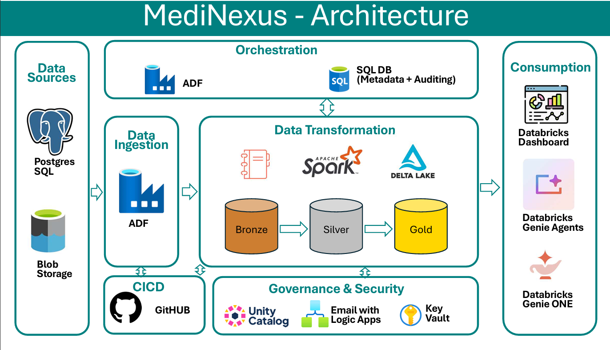

### Architecture Flow

**Data Sources → Azure Data Factory → Landing → Bronze → Silver → Gold → Analytics**

- **Azure Data Factory** — metadata-driven ingestion and orchestration
- **Azure Databricks + PySpark** — data transformation and processing
- **Delta Lake** — storage across the Bronze, Silver, and Gold layers
- **Azure SQL Database** — metadata, watermark, and audit management
- **Unity Catalog** — data governance
- **Azure Key Vault** — secure credential management
- **Logic Apps** — execution notifications
- **Databricks Dashboards & Genie** — analytics and data consumption

---

## Technology Stack

| Technology | Purpose |
|---|---|
| **Azure Data Factory** | Metadata-driven ingestion and orchestration |
| **Azure Data Lake Storage Gen2** | Landing and data storage |
| **Azure Databricks** | Data processing and transformation |
| **Apache Spark / PySpark** | Distributed data processing |
| **Delta Lake** | Transactional data storage |
| **Unity Catalog** | Data governance and access control |
| **Azure SQL Database** | Metadata, watermark, and audit management |
| **Azure Key Vault** | Secure secret management |
| **Azure Logic Apps** | Automated email notifications |
| **GitHub** | Source control |
| **Databricks Dashboards** | Healthcare analytics |
| **Databricks Genie** | Natural-language data exploration |

---

## Source Systems

MediNexus integrates healthcare data from multiple source systems and file-based datasets through a common metadata-driven ingestion framework.

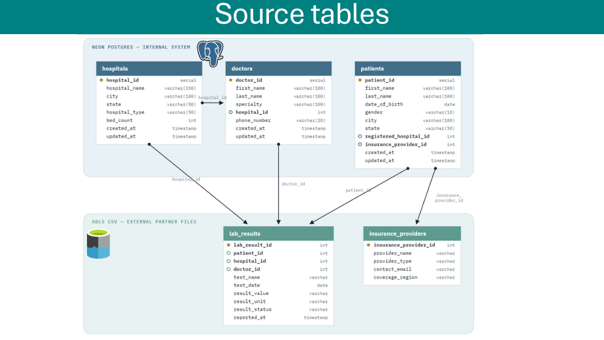

### 1. Neon PostgreSQL

Operational healthcare data is sourced from PostgreSQL tables:

- `hospitals`
- `doctors`
- `patients`

These datasets are ingested through Azure Data Factory and processed through the Landing, Bronze, and Silver layers.

### 2. ADLS CSV Sources

External healthcare datasets are provided as CSV files:

- `lab_results`
- `insurance_providers`

These datasets use the same metadata-driven ingestion framework and are processed through the Landing, Bronze, and Silver layers.

### Source Integration

| Source | Datasets | Format | Ingestion |
|---|---|---|---|
| **Neon PostgreSQL** | hospitals, doctors, patients | PostgreSQL | Azure Data Factory |
| **ADLS CSV** | lab_results, insurance_providers | CSV | Azure Data Factory |

---

## Data Layers

MediNexus implements the **Landing → Bronze → Silver → Gold** processing layers described in the architecture above.

### Landing Layer

The Landing layer provides the raw ingestion boundary between source systems and Databricks processing.

MediNexus organizes incoming data by source system and source dataset within the Unity Catalog external volume.

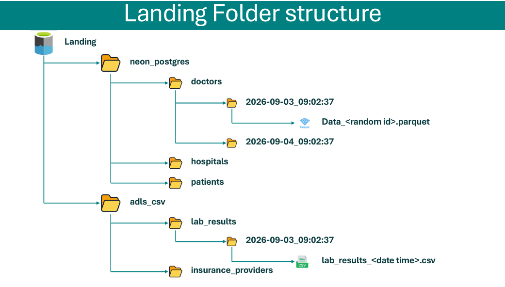

The current landing structure separates data by source:

- **`neon_postgres`** — `hospitals`, `doctors`, `patients`
- **`adls_csv`** — `lab_results`, `insurance_providers`

Azure Data Factory manages the ingestion of source data into the Landing layer before Databricks processing.

### Bronze Layer

The Bronze layer stores the ingested datasets as **Delta tables** in Databricks.

Current Bronze datasets include:

- `hospitals`
- `doctors`
- `patients`
- `lab_results`
- `insurance_providers`

Bronze provides a reliable Delta-based processing layer while keeping source ingestion separate from business-level transformations.

### Silver Layer

The Silver layer contains cleaned and transformed datasets prepared for downstream analytical processing.

Silver processing includes:

- Data transformation and standardization
- Deduplication
- Incremental processing
- Merge/upsert processing
- Append processing
- Full-load processing
- Data quality validation
- Audit timestamp generation

The Silver layer provides the primary business-ready datasets used by the Gold transformations.

### Gold Layer

The Gold layer contains analytics-ready datasets designed for business consumption.

MediNexus currently produces three major Gold datasets:

- `patient_360`
- `hospital_daily_summary`
- `lab_test_trends`

### 1. Patient 360

`patient_360` provides a consolidated patient-level analytical view containing:

- Patient information
- Hospital association
- Insurance information
- Total laboratory tests
- Abnormal tests
- Critical tests
- Latest test date
- Patient age

The dataset maintains one analytical record per patient.

### 2. Hospital Daily Summary

`hospital_daily_summary` provides hospital-level analytical metrics such as:

- Hospital
- Test date
- Day name
- Weekend indicator
- Total tests
- Unique patients
- Active doctors
- Abnormal tests
- Critical tests
- Previous available day metrics
- Test volume changes

Window functions such as `LAG()` are used for previous-period comparisons.

### 3. Lab Test Trends

`lab_test_trends` provides laboratory testing trends across time.

Metrics include:

- Test month
- Test name
- Total tests
- Abnormal tests
- Critical tests
- Abnormal rate
- Previous-month abnormal rate
- Abnormal rate change

The month-over-month abnormal rate change is represented as a **percentage-point difference**.

## Metadata-Driven Framework

MediNexus uses a **metadata-driven framework** where Azure SQL control tables define how each dataset is ingested, transformed, and monitored. This allows the same ADF pipeline logic to process multiple datasets without hard-coded table-specific pipelines.

---

## Load Types

The framework supports three load strategies:

### FULL

Loads the complete source dataset and refreshes the target dataset.

### APPEND

Adds new records to the existing Silver dataset. `lab_results` currently uses an append-oriented incremental pattern.

### MERGE

Updates existing records and inserts new records based on configured merge keys. `patients` currently uses a MERGE strategy.

---

## Metadata Control Tables

MediNexus uses three centralized Azure SQL control tables to manage configuration, incremental state, and pipeline execution.

### `ctrl.table_config`

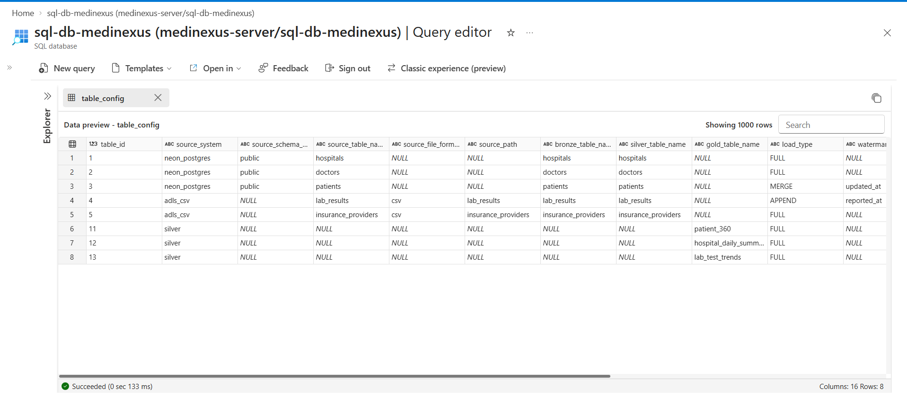

Defines source and target configuration, load type, watermark column, merge keys, processing stage, and active status.

### `ctrl.watermark`

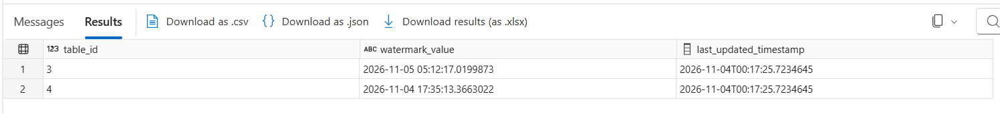

Maintains the incremental processing state, including the current watermark value and its update information.

### `ctrl.audit_log`

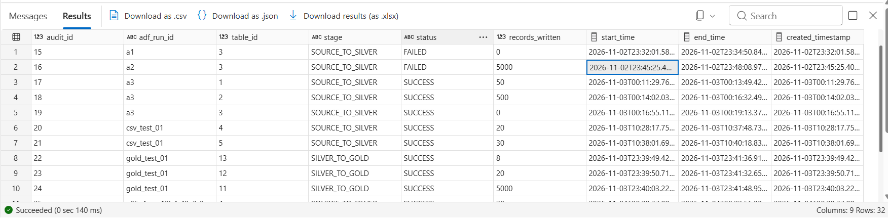

Tracks table-level pipeline execution using the ADF run ID, table ID, processing stage, status, record count, and execution timestamps.

The control-table framework provides a centralized mechanism for **configuration, incremental processing, and execution tracking**.

# Azure Data Factory Architecture

Azure Data Factory acts as the **orchestration layer** of MediNexus. It manages source ingestion, metadata-driven table processing, Databricks notebook execution, audit handling, watermark processing, and Gold-layer orchestration.

The ADF architecture is built around a reusable pipeline hierarchy rather than separate hard-coded pipelines for each source table.

## Pipeline Architecture

The main orchestration pipeline is `PL_MASTER`.

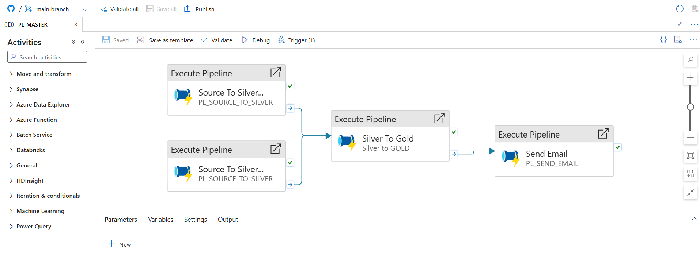

`PL_MASTER` coordinates the major processing stages:

```text
                         PL_MASTER
                             |
              +--------------+--------------+
              |                             |
              v                             v
      PL_SOURCE_TO_SILVER          PL_SOURCE_TO_SILVER
        Neon PostgreSQL                ADLS CSV
              |                             |
              +--------------+--------------+
                             |
                             v
                     Silver to GOLD
```

The PostgreSQL and ADLS CSV ingestion branches are executed independently, while Gold processing runs after the required upstream processing completes.

---

## ADF Pipeline Hierarchy

### 1. PL_MASTER

`PL_MASTER` is the top-level orchestration pipeline.

It is responsible for:

- Starting PostgreSQL source processing
- Starting ADLS CSV source processing
- Passing the master `adf_run_id` to child pipelines
- Coordinating the upstream processing branches
- Starting the Silver-to-Gold processing stage

---

### 2. PL_SOURCE_TO_SILVER

`PL_SOURCE_TO_SILVER` is the metadata-driven outer pipeline.

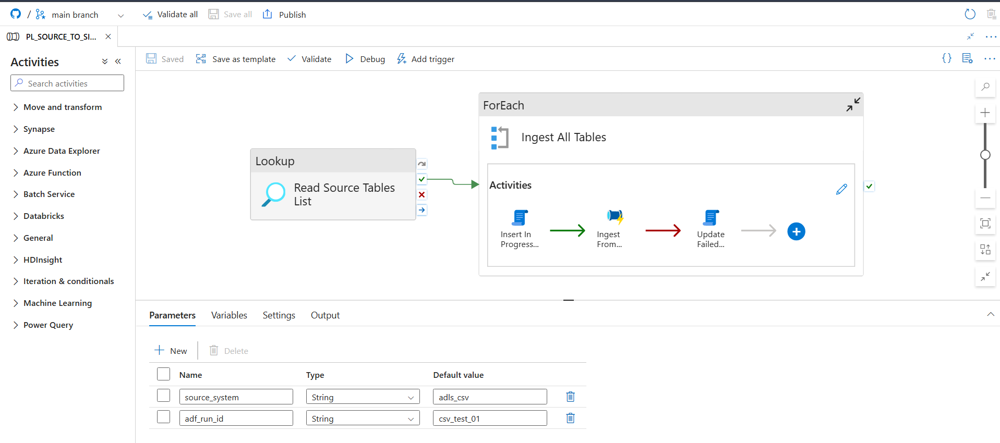

It:

1. Queries `ctrl.table_config` for active tables belonging to the selected source system.
2. Retrieves the corresponding `table_id` values.
3. Iterates through the returned metadata using a ForEach activity.
4. Invokes `PL_SOURCE_TO_SILVER_INNER` for each table.
5. Passes the required `table_id` and `adf_run_id` to the inner pipeline.

This allows the same processing framework to handle multiple source tables without creating separate pipelines for each table.

---

### 3. PL_SOURCE_TO_SILVER_INNER

`PL_SOURCE_TO_SILVER_INNER` performs the processing for an individual metadata-defined table.

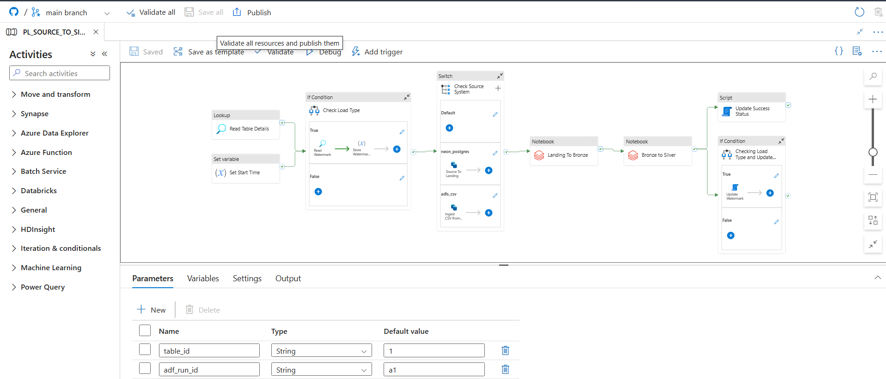

The pipeline performs the following steps:

- Read table configuration from `ctrl.table_config`
- Capture the processing start time
- Determine the configured load type
- Read the watermark when required
- Select the appropriate source-processing path
- Copy source data into the Landing layer
- Execute Landing → Bronze processing
- Execute Bronze → Silver processing
- Record audit information
- Update the watermark after successful processing

The same inner pipeline is reused for different tables and load strategies such as **Full, Append, and Merge**.

---

### 4. Silver to GOLD

The `Silver to GOLD` pipeline manages the final transformation stage.

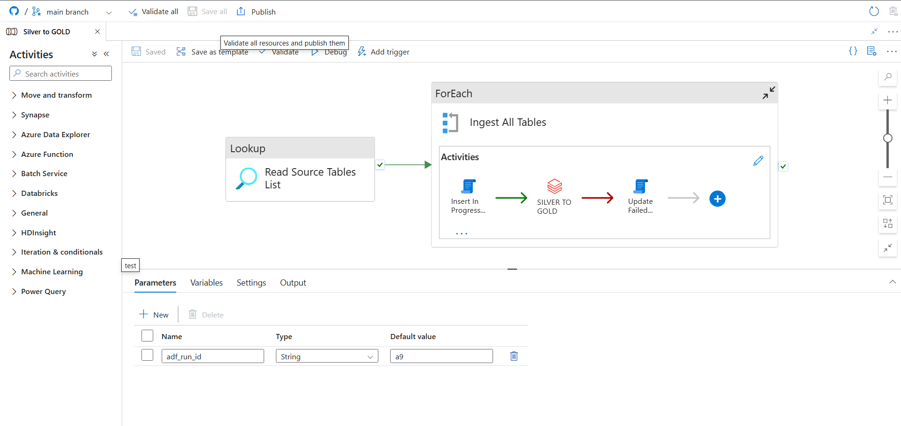

It uses the Gold-stage metadata configuration to determine which Gold dataset needs to be processed and dynamically invokes the corresponding Databricks notebook.

Conceptually:

```text
                 ctrl.table_config
                        |
                        v
                gold_table_name
                        |
                        v
              Dynamic Notebook Path
                  /      |       \
                 /       |        \
                v        v         v
        patient_360   hospital_   lab_test_
                     daily_summary  trends
```

This metadata-driven approach allows new Gold datasets to be integrated by extending the configuration rather than creating a completely new orchestration framework.

---

## ADF Execution Flow

The overall processing sequence is:

```text
Source Systems
      |
      v
   PL_MASTER
      |
      +-----------------------+
      |                       |
      v                       v
PostgreSQL              ADLS CSV
      |                       |
      v                       v
PL_SOURCE_TO_SILVER    PL_SOURCE_TO_SILVER
      |                       |
      v                       v
PL_SOURCE_TO_SILVER_INNER
      |
      +--> Landing
      |
      +--> Bronze
      |
      +--> Silver
      |
      +-----------------------+
                              |
                              v
                       Silver to GOLD
                              |
                              v
                     Gold Databricks
                        Notebooks
```

The architecture provides a **reusable, metadata-driven orchestration framework** in which source-specific ingestion and table-level processing are separated from the overall pipeline orchestration.

# Databricks Architecture

Azure Databricks is the **data processing and transformation layer** of MediNexus. PySpark notebooks process the ingested data across the Bronze, Silver, and Gold layers using Delta Lake.

The Databricks environment is organized using **Unity Catalog**.

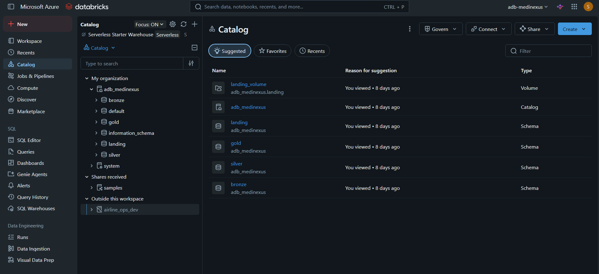

The primary catalog is:

```text
adb_medinexus
├── landing
├── bronze
├── silver
└── gold
```

This structure separates the different processing stages while providing a consistent governance boundary for the platform.

---

# Unity Catalog

MediNexus uses **Unity Catalog** to organize and govern the Databricks data platform through the `adb_medinexus` catalog and its `landing`, `bronze`, `silver`, and `gold` schemas.

The Landing layer uses the external volume:

```text
adb_medinexus.landing.landing_volume
```

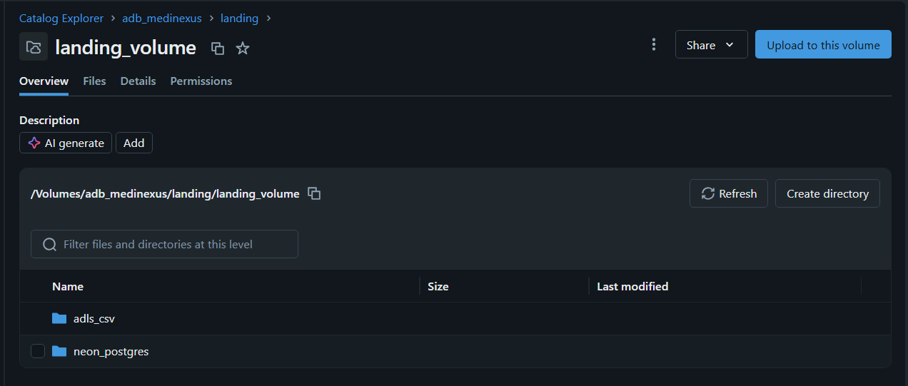

The external volume provides the Databricks-accessible storage location for the Landing layer.

## Medallion Architecture in Databricks

MediNexus implements **Bronze → Silver → Gold** processing using Delta tables in Databricks.

### Bronze

Bronze stores the ingested source datasets as Delta tables.

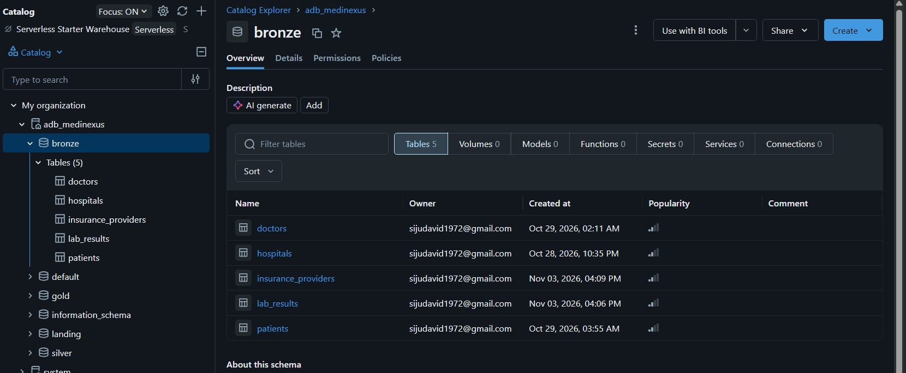

Current datasets: `hospitals`, `doctors`, `patients`, `lab_results`, and `insurance_providers`.

### Silver

Silver contains cleaned and transformed datasets with **standardization, deduplication, incremental processing, Full/Append/Merge handling, and data quality validation**.

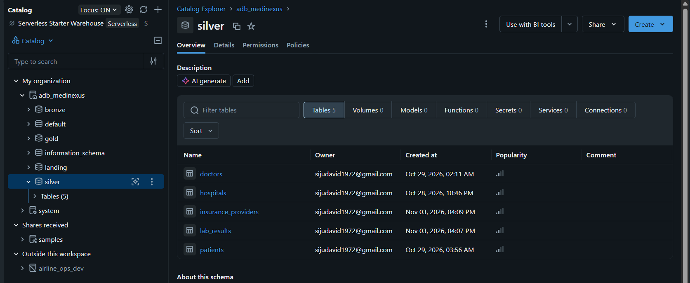

### Gold

Gold contains the curated analytical datasets:

- `patient_360`
- `hospital_daily_summary`
- `lab_test_trends`

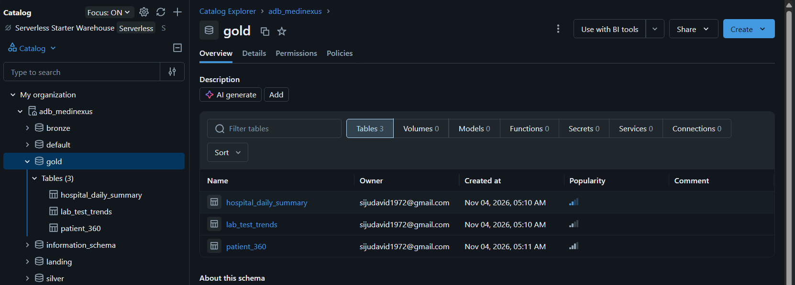

---

# Delta Lake

Delta Lake is used as the storage format for the **Bronze, Silver, and Gold** datasets. MediNexus uses Delta Lake for **ACID transactions, reliable table updates, schema enforcement and evolution, time travel, transaction history, and `MERGE` operations**.

Each Delta table maintains its transaction history through the `_delta_log` directory. Together, **Delta Lake, Unity Catalog, and Databricks** provide the storage, processing, and governance foundation for the MediNexus data platform.

# Data Quality Validation

Data quality checks were performed across the Medallion layers.

Examples include:

### Key validation

- Null primary/business keys
- Duplicate business keys

### Record-count validation

- Source-to-Bronze counts
- Bronze-to-Silver counts
- Silver-to-Gold reconciliation

### Metric reconciliation

Gold metrics were independently reconciled against Silver data.

Examples:

- Total laboratory tests
- Abnormal tests
- Critical tests
- Unique patients
- Active doctors
- Monthly trends

---

# Data Validation Results

The current project validation includes:

| Dataset | Records |
|---|---:|
| Bronze hospitals | 50 |
| Bronze doctors | 500 |
| Bronze patients | 5,000 |
| Bronze lab_results | 20 |
| Bronze insurance_providers | 30 |
| Silver hospitals | 50 |
| Silver doctors | 500 |
| Silver patients | 5,000 |
| Silver lab_results | 20 |
| Silver insurance_providers | 30 |
| Gold patient_360 | 5,000 |
| Gold hospital_daily_summary | 20 |
| Gold lab_test_trends | 8 |

The Gold datasets operate at different grains, so their row counts should not be expected to match the Silver source row counts directly.

---

# Healthcare Analytics Dashboard

MediNexus includes a **Databricks Healthcare Analytics Dashboard** built on the curated Gold datasets.

The dashboard provides four analytical views:

1. **Executive Healthcare Overview**
2. **Patient Analytics**
3. **Hospital Performance**
4. **Laboratory Analytics**

## Executive Healthcare Overview

Provides a high-level view of healthcare metrics and overall platform data.

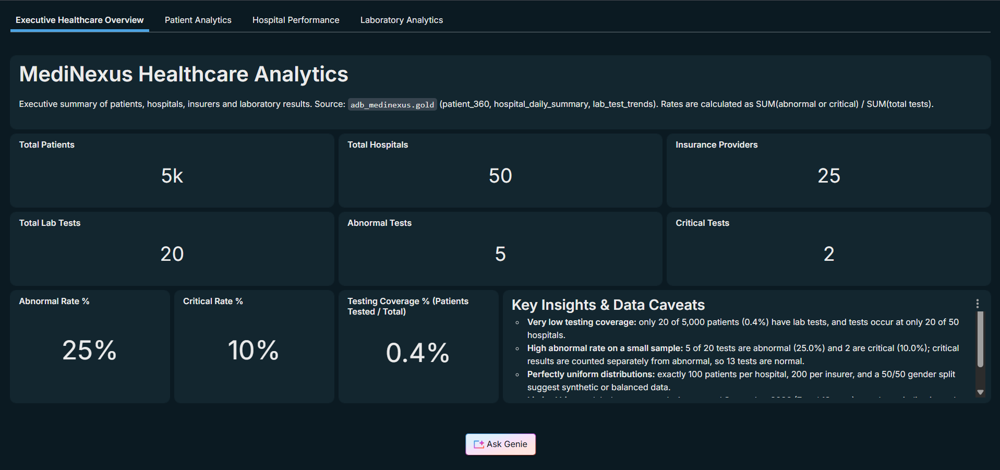

---

## Patient Analytics

Provides patient-level and population-oriented analytical views based on the curated healthcare data.

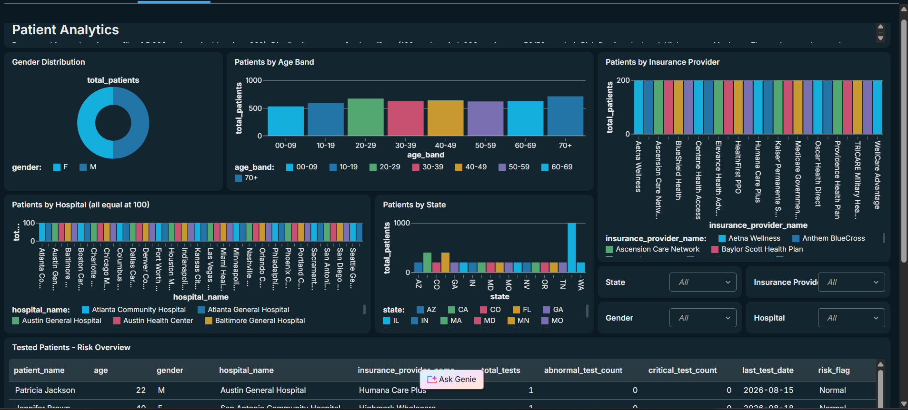

---

## Hospital Performance

Provides analytical views for hospital-level metrics and performance.

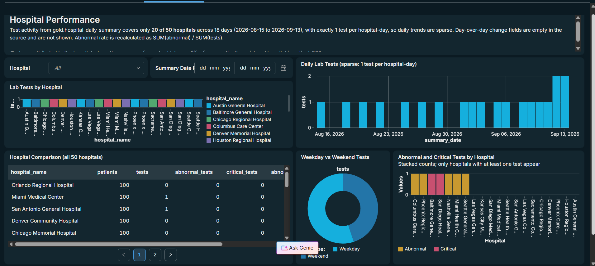

---

## Laboratory Analytics

Provides analytical views of laboratory testing activity and related healthcare metrics.

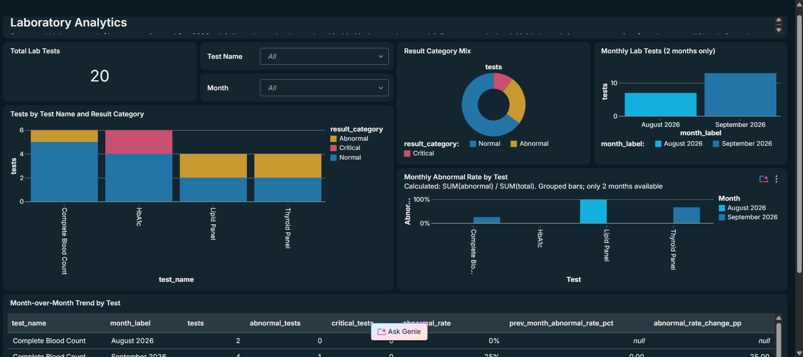

The dashboard consumes the **Gold-layer datasets** produced by the MediNexus data pipeline, providing a final analytics and consumption layer for the platform.


## Databricks Genie

MediNexus also includes a **Databricks Genie** experience for natural-language analytics. Users can ask questions about the curated Gold datasets in plain English without manually writing SQL.

### Examples

<table>
  <tr>
    <td align="center">
      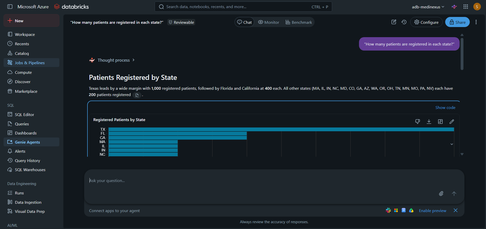
    </td>
    <td align="center">
      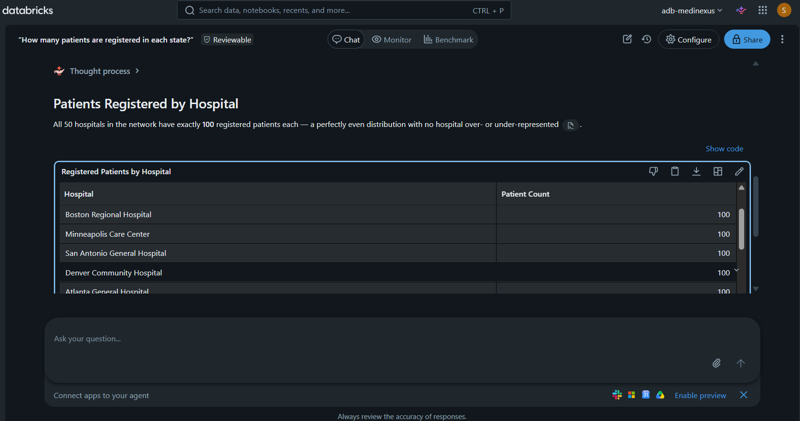
    </td>
  </tr>
  <tr>
    <td align="center"><b>Patients Registered by State</b></td>
    <td align="center"><b>Patients Registered by Hospital</b></td>
  </tr>
</table>

# Pipeline Monitoring and Audit

Pipeline execution is tracked using the centralized audit framework.

Each processed table can generate an audit record containing:

```text
ADF Run ID
Table ID
Stage
Status
Records Written
Start Time
End Time
```

This provides visibility into individual table processing rather than relying only on the overall pipeline status.

---

# Email Notification

MediNexus uses an Azure Logic App for pipeline notification.

The architecture is:

```text
Azure Data Factory
       |
       | HTTP POST
       v
Azure Logic App
       |
       v
Email Notification
```

The notification can contain:

- Pipeline status
- Run information
- Table-level processing status
- Records written
- Execution information

<!-- SCREENSHOT PLACEHOLDER
Add successful MediNexus email notification screenshot.

Suggested file:
docs/images/pipeline-success-email.png
-->

```text
[ SCREENSHOT — SUCCESS EMAIL ]
```

---

# Security and Governance

Security-related Azure services are incorporated into the platform.

## Azure Key Vault

MediNexus uses **Azure Key Vault** to securely manage credentials required by the data platform. Secrets are stored in Key Vault rather than being hard-coded in pipeline configurations.

The development environment contains secrets for the Databricks, Azure SQL Database, and PostgreSQL connections.

<table>
  <tr>
    <td align="center">
      
    </td>
    <td align="center">
      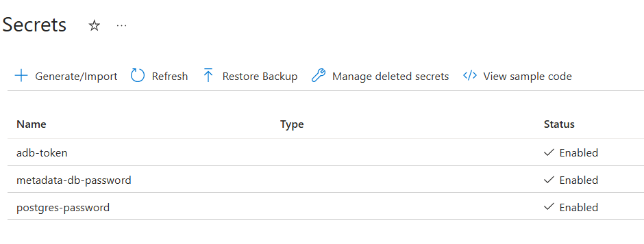
    </td>
  </tr>
  <tr>
    <td align="center"><b>Key Vault Overview</b></td>
    <td align="center"><b>Configured Secrets</b></td>
  </tr>
</table>

## Unity Catalog

Unity Catalog provides centralized governance for Databricks data assets.

---

## Azure SQL Control Database

Metadata and audit information are maintained separately from the analytical data.

This provides a centralized control plane for the ingestion framework.

---

# GitHub Source Control

MediNexus uses separate repositories for different responsibilities.

### Azure Data Factory

Repository:

```text
medinexus-azure-data-factory
```

Contains ADF-related source-controlled artifacts such as:

```text
dataset/
factory/
linkedService/
pipeline/
trigger/
README.md
publish_config.json
```

---

### Azure Databricks

Repository:

```text
medinexus-adb-repo
```

Contains Databricks notebooks and related Databricks project assets.

---

### Portfolio Repository

Repository:

```text
medinexus-azure-data-platform
```

This repository is intended for:

- Architecture documentation
- Project explanation
- Screenshots
- Design decisions
- Implementation notes
- Data validation evidence
- CI/CD documentation
- Interview reference material

The portfolio repository is intentionally separated from the application/source repositories.

---

# Repository Architecture

```text
GitHub
│
├── medinexus-azure-data-factory
│   └── Azure Data Factory source control
│
├── medinexus-adb-repo
│   └── Azure Databricks source control
│
└── medinexus-azure-data-platform
    ├── README.md
    ├── docs/
    ├── architecture/
    ├── screenshots/
    └── documentation/
```

---

# CI/CD

MediNexus is being developed with Git-based source control and a separation between:

- ADF source code
- Databricks source code
- Portfolio documentation

The next phase of the project is to implement and document a more complete CI/CD workflow for the platform.

The intended direction is:

```text
Developer
    |
    v
Feature Branch
    |
    v
Pull Request
    |
    v
Code Review
    |
    v
Main Branch
    |
    v
Deployment Pipeline
    |
    +---------> Azure Data Factory
    |
    +---------> Azure Databricks
```

> **Status:** Git-based source control is established. Full automated CI/CD is a work in progress and will be documented here as it is implemented.

---

# Current Data Processing Configuration

The current metadata framework contains configurations for:

| Source | Dataset | Load Type | Incremental Column | Merge Key |
|---|---|---|---|---|
| Neon PostgreSQL | hospitals | FULL | — | — |
| Neon PostgreSQL | doctors | FULL | — | — |
| Neon PostgreSQL | patients | MERGE | `updated_at` | `patient_id` |
| ADLS CSV | lab_results | APPEND | `reported_at` | — |
| ADLS CSV | insurance_providers | FULL | — | — |

Gold processing includes:

| Gold Dataset | Processing |
|---|---|
| patient_360 | FULL |
| hospital_daily_summary | FULL |
| lab_test_trends | FULL |

---

# Project Data Flow

The complete processing flow can be summarized as:

```text
                     SOURCE
                       |
          +------------+------------+
          |                         |
   PostgreSQL                    CSV Files
          |                         |
          +------------+------------+
                       |
                       v
                Azure Data Factory
                       |
                       v
                 Metadata Lookup
                       |
                       v
                    Landing
                       |
                       v
                    Bronze
                       |
                       v
                    Silver
                       |
              +--------+--------+
              |        |       |
              v        v       v
          Patient   Hospital   Lab
            360      Summary   Trends
              \        |       /
               \       |      /
                +------+-----+
                       |
                       v
                Analytics Layer
                       |
          +------------+------------+
          |                         |
      Dashboard                  Genie
```

---

# Error Handling and Monitoring

The platform is designed to provide operational visibility through:

- ADF pipeline execution status
- Table-level audit logging
- Metadata-driven execution
- Watermark tracking
- Logic App notifications
- Databricks notebook execution monitoring

This allows failures to be investigated at the table/stage level rather than treating the entire platform as a single black box.

---

# Performance and Spark Optimization

The Databricks implementation also demonstrates Spark optimization concepts.

Techniques explored in the project include:

- Broadcast joins
- Data skew mitigation
- Z-ORDER
- Efficient Delta processing
- Incremental processing
- Partition-aware processing
- Idempotent pipeline design

These techniques are particularly relevant when processing larger datasets in production-scale Spark environments.

---

# Idempotency

The pipeline design aims to support repeatable processing.

The use of:

- Metadata configuration
- Controlled landing paths
- Delta tables
- MERGE operations
- Audit logging
- Watermark-based incremental processing

helps make pipeline execution more predictable and easier to recover.

---

# Current Validation and Testing

The platform has been tested through multiple validation layers.

### Pipeline validation

- ADF master pipeline execution
- Source-to-Silver execution
- Silver-to-Gold execution
- Audit log verification
- Email notification verification

### Data validation

- Record counts
- Null checks
- Duplicate checks
- Business-key validation
- Gold metric reconciliation
- Monthly trend validation
- Hospital-day metric validation

### Analytical validation

- Patient 360 metrics
- Hospital summary metrics
- Laboratory trend calculations
- Window-function calculations
- Percentage-point changes

---

# Screenshots

This section will be expanded as the project documentation is finalized.

## Architecture

<!-- ADD SCREENSHOT HERE -->

```text
[ Architecture Diagram ]
```

---

## Azure Resource Group

<!-- ADD SCREENSHOT HERE -->

```text
[ Azure Resource Group Screenshot ]
```

---

## Azure Data Factory

### PL_MASTER

<!-- ADD SCREENSHOT HERE -->

```text
[ PL_MASTER Screenshot ]
```

### Source-to-Silver Pipeline

<!-- ADD SCREENSHOT HERE -->

```text
[ SOURCE_TO_SILVER Screenshot ]
```

### Silver-to-Gold Pipeline

<!-- ADD SCREENSHOT HERE -->

```text
[ SILVER_TO_GOLD Screenshot ]
```

---

## Metadata Control Tables

### table_config

<!-- ADD SCREENSHOT HERE -->

```text
[ ctrl.table_config Screenshot ]
```

### watermark

<!-- ADD SCREENSHOT HERE -->

```text
[ ctrl.watermark Screenshot ]
```

### audit_log

<!-- ADD SCREENSHOT HERE -->

```text
[ ctrl.audit_log Screenshot ]
```

---

## Databricks

### Unity Catalog

<!-- ADD SCREENSHOT HERE -->

```text
[ Unity Catalog Screenshot ]
```

### Bronze

<!-- ADD SCREENSHOT HERE -->

```text
[ Bronze Screenshot ]
```

### Silver

<!-- ADD SCREENSHOT HERE -->

```text
[ Silver Screenshot ]
```

### Gold

<!-- ADD SCREENSHOT HERE -->

```text
[ Gold Screenshot ]
```

---

## Dashboard

<!-- ADD SCREENSHOT HERE -->

```text
[ Dashboard Screenshot ]
```

---

## Databricks Genie

<!-- ADD SCREENSHOT HERE -->

```text
[ Genie Screenshot ]
```

---

## Pipeline Email Notification

<!-- ADD SCREENSHOT HERE -->

```text
[ Email Screenshot ]
```

---

## GitHub

### ADF Repository

<!-- ADD SCREENSHOT HERE -->

```text
[ ADF GitHub Repository Screenshot ]
```

### Databricks Repository

<!-- ADD SCREENSHOT HERE -->

```text
[ Databricks GitHub Repository Screenshot ]
```

### Portfolio Repository

<!-- ADD SCREENSHOT HERE -->

```text
[ Portfolio GitHub Repository Screenshot ]
```

---

# Project Repository Links

### Azure Data Factory Source

`medinexus-azure-data-factory`

### Azure Databricks Source

`medinexus-adb-repo`

### MediNexus Portfolio

`medinexus-azure-data-platform`

---

# Project Structure

The portfolio repository will progressively contain documentation and visual evidence.

```text
medinexus-azure-data-platform/
│
├── README.md
│
├── architecture/
│   ├── medinexus-architecture.png
│   └── data-flow.png
│
├── docs/
│   ├── architecture.md
│   ├── metadata-framework.md
│   ├── medallion-architecture.md
│   ├── data-quality.md
│   ├── monitoring.md
│   └── cicd.md
│
├── screenshots/
│   ├── azure/
│   ├── adf/
│   ├── databricks/
│   ├── dashboard/
│   ├── genie/
│   └── github/
│
└── README.md
```

---

# Key Engineering Concepts Demonstrated

This project demonstrates practical implementation of:

- Azure Data Factory
- Metadata-driven pipelines
- Parameterized pipelines
- Dynamic pipeline execution
- ForEach processing
- Lookup activities
- Execute Pipeline activities
- Conditional orchestration
- Incremental loading
- Watermark processing
- Full loading
- Append loading
- Merge/upsert processing
- ADLS Gen2
- Azure Databricks
- Apache Spark
- PySpark
- Delta Lake
- Unity Catalog
- Medallion Architecture
- Azure SQL metadata frameworks
- Audit logging
- Data quality validation
- Spark optimization
- Window functions
- Healthcare analytics
- Databricks Dashboards
- Databricks Genie
- Azure Key Vault
- Logic Apps
- GitHub source control
- CI/CD architecture

---

# Future Enhancements

The platform will continue to evolve.

Potential enhancements include:

- Complete automated CI/CD implementation
- Automated deployment of Databricks notebooks
- Automated ADF deployment
- Improved watermark management
- Late-arriving data handling
- More robust no-file handling
- Expanded data quality framework
- Automated test execution
- Additional healthcare analytical datasets
- More dashboard pages
- Improved data lineage documentation
- Environment separation such as Dev / Test / Production
- Automated infrastructure deployment
- Enhanced monitoring and alerting

---

# Lessons Learned

The project provides practical experience in designing a production-oriented Azure Data Engineering platform.

Key areas of learning include:

### Metadata-driven architecture

Centralized metadata can significantly reduce pipeline duplication and simplify onboarding of new datasets.

### Medallion Architecture

Separating raw, validated, and business-ready data improves organization and maintainability.

### Incremental processing

Watermark-based ingestion reduces unnecessary processing but requires careful handling of late-arriving and updated records.

### Delta Lake

Delta provides reliable transactional capabilities that are valuable for modern data lake architectures.

### Unity Catalog

Centralized governance becomes increasingly important as the number of datasets and users grows.

### Orchestration

Separating master, outer, and inner pipelines makes complex metadata-driven workflows easier to manage.

### Data validation

Successful pipeline execution does not necessarily mean the data is correct. Independent reconciliation of Gold metrics against Silver data is an important part of the implementation.

---

# Interview Highlights

MediNexus can be used to demonstrate practical understanding of the following interview topics:

## Azure Data Factory

- Metadata-driven pipelines
- Lookup
- ForEach
- Execute Pipeline
- Parameters
- Dynamic content
- Dependency conditions
- Incremental ingestion
- Watermark management
- Error handling
- Audit logging

## Databricks

- Spark architecture
- PySpark
- Delta Lake
- Medallion Architecture
- Unity Catalog
- Delta MERGE
- Structured transformations
- Window functions
- Spark optimization

## SQL

- CTEs
- Window functions
- Aggregations
- Conditional logic
- Metadata queries
- Audit queries
- Incremental filtering

## Azure

- ADLS Gen2
- Azure SQL Database
- Azure Key Vault
- Azure Data Factory
- Azure Databricks
- Logic Apps

## DevOps

- Git
- GitHub
- Feature branches
- Pull requests
- Repository separation
- CI/CD architecture

---

# Project Status

| Area | Status |
|---|---|
| Azure infrastructure | Completed |
| Source ingestion | Completed |
| Metadata framework | Completed |
| Landing layer | Completed |
| Bronze layer | Completed |
| Silver layer | Completed |
| Gold layer | Completed |
| Unity Catalog | Completed |
| Delta Lake implementation | Completed |
| Audit logging | Completed |
| Dashboard | Completed |
| Databricks Genie | Implemented |
| Email notification | Completed |
| GitHub source control | Implemented |
| Portfolio repository | Initial setup |
| Automated CI/CD | In progress |
| Advanced watermark handling | Enhancement in progress |

---

# Author

**Alvin David**

Azure Data Engineering Project

Focus areas:

- Azure Data Factory
- Azure Databricks
- PySpark
- Delta Lake
- Unity Catalog
- SQL
- Azure Data Engineering
- Metadata-Driven Architecture

---

## Disclaimer

This is a personal Azure Data Engineering portfolio project created for learning, engineering practice, and demonstration of modern data platform concepts.

The healthcare datasets used in the project are demonstration data and should not be interpreted as real patient information.
